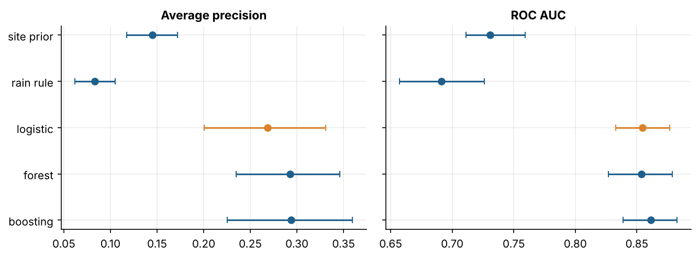
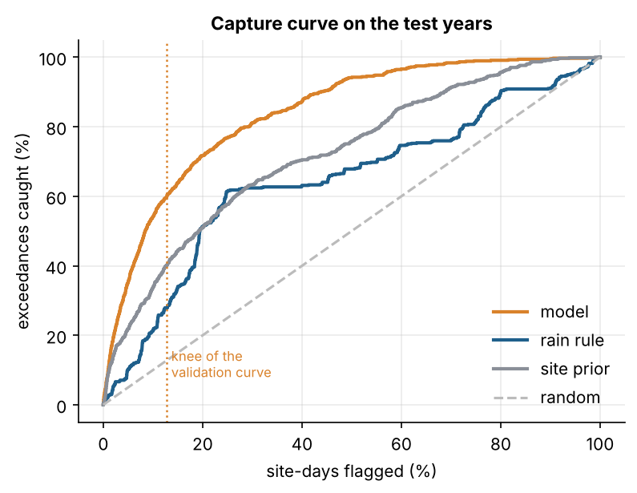
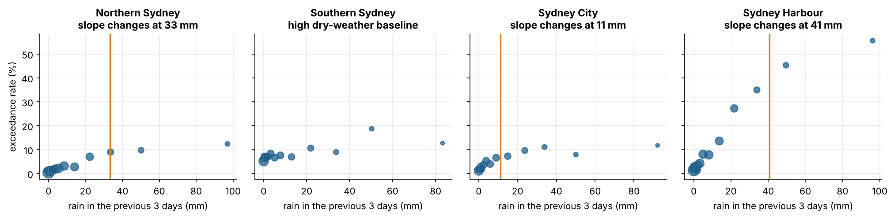
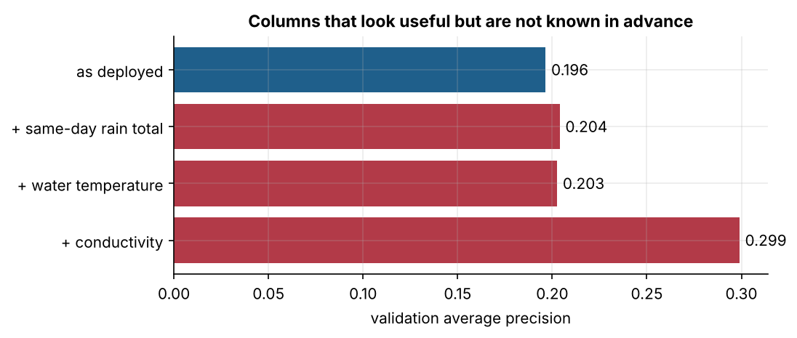
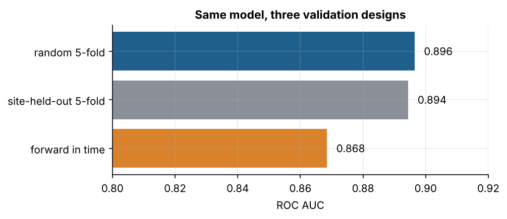
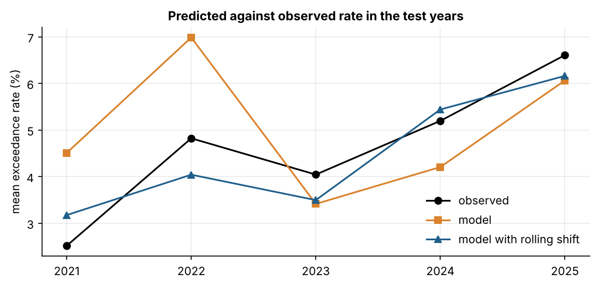
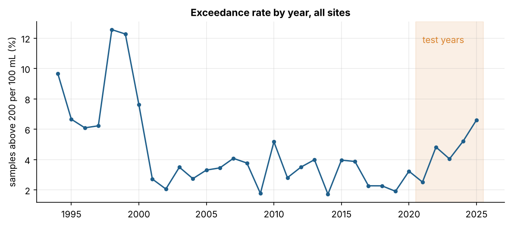
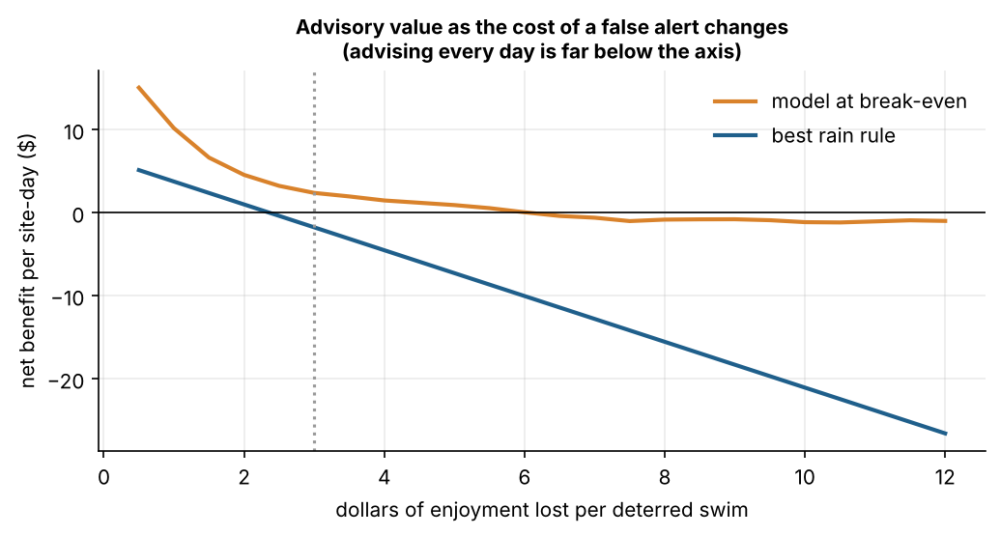

# tidewatch

[](https://github.com/ranjithguggilla/tidewatch/actions/workflows/ci.yml)

Tidewatch estimates, the morning before a sample is taken, how likely a Sydney swim site is to fail on enterococci (more than 200 per 100 mL). It uses the rain record up to the previous day, the site's own history and lab results that are at least two days old. It is validated forward in time on 2021 to April 2025 and compared against what a council would otherwise do: a plain rain rule or the site's long-run failure rate.

I built it to answer a narrow question. Rain clearly drives beach pollution in Sydney, but how much better is a model than the "closed after heavy rain" rule that most advisories are built on, once you score it on years it never saw?

## Results

Test years are 2021-01-04 to 2025-04-28: 15,557 samples at 79 sites, 4.4% of them above 200 per 100 mL. Training ran to the end of 2016, validation covered 2017 to 2020, and the shipped model was refit on everything before 2021. Intervals are 95% month-cluster bootstraps (300 draws), because samples taken in the same month share the same weather.

| Model | ROC AUC | Average precision | Log loss | Share of exceedances in top 10% of site-days |
|---|---|---|---|---|
| Site failure rate only | 0.731 [0.711, 0.759] | 0.145 [0.117, 0.172] | 0.1629 | 33.8% |
| Rain rule (1-day rain, 3 mm) | 0.691 [0.657, 0.726] | 0.083 [0.062, 0.105] | 0.1683 | 21.4% |
| Logistic regression (shipped) | 0.854 [0.833, 0.877] | 0.269 [0.200, 0.331] | 0.1386 | 54.1% |
| Random forest | 0.854 [0.827, 0.879] | 0.293 [0.235, 0.346] | 0.1386 | 54.9% |
| Gradient boosting | 0.861 [0.839, 0.883] | 0.294 [0.225, 0.360] | 0.1365 | 54.4% |

Boosting had the lowest validation log loss (0.0882), but logistic regression sat inside one standard error of it (0.0930 against a standard error of 0.0106), so the one-standard-error rule picked the simpler model. On the test years the gap between them is inside the noise, which is what the rule was guarding against. Calibration is good for the shipped model (expected calibration error 0.007).

Against the two baselines the shipped model gains 0.0298 log loss over the rain rule (95% interval 0.0239 to 0.0352) and 0.0244 over the site rate (0.0159 to 0.0318).





The capture curve bends at about 13% of site-days flagged (kneed finds the same point on validation and on test). By that point the model has caught 61% of the exceedances in the test years.

### What drives the score

I shuffled each feature group on the test years and measured how much average precision fell. Site history cost 0.155 and recent rain cost 0.142. Season cost 0.010. Neighbouring-site readings and region cost nothing measurable (both within 0.007 of zero), so the nearest-site features computed with shapely turned out to be redundant once a site's own record is known.

Rain does not behave the same way everywhere. The charts below plot the exceedance rate against the previous three days of rain. Sydney Harbour keeps climbing with rain (about 10 points per 10 mm below roughly 41 mm, about 2 above), whereas Sydney City flattens out after about 11 mm. Southern Sydney already fails 5.2% of dry-weather samples, so its rain curve is mostly a chronic baseline and I did not fit a break to it.



Distance correlation between the log bacteria count and rain is highest for yesterday's rain (0.31) and falls steadily for longer windows (0.29 for 3 days, 0.25 for 7, 0.16 for 30).

### Checks on the evaluation itself

Adding columns that are only known once someone is standing in the water inflates the score. Conductivity lifts validation average precision from 0.197 to 0.299, even though it is missing for roughly 60% of samples. The rain total for the sampling day itself adds very little (0.204), which I did not expect. None of these are model inputs.



Random folds look better than forward-in-time scoring. Under 5-fold random splits the same boosting model reaches an AUC of 0.896, holding out whole sites gives 0.894, and scoring forward in time gives 0.868. Part of that gap is plain prevalence shift (the validation years fail 2.4% of the time against 4.7% over the development years), so I compare AUC and not average precision here.



The base rate drifts. Exceedance rates were high in the 1990s, stayed between 2 and 5% through the 2010s and rose again to 6.6% in the first months of 2025. The shipped model predicts 4.9% on average over the test years against 4.4% observed. Shifting the logit month by month so the last 365 days of predictions match the last 365 days of outcomes lowers expected calibration error from 0.0072 to 0.0034 and log loss only from 0.1386 to 0.1380, so the drift is real but cheap to live with.





### What it is worth

This part rests on assumptions I made up and state openly, so treat it as a template. I assume 200 swimmers per site-day, a 3% chance of illness on an exceedance day at $250 per illness, half the swimmers staying out after an advisory, and $3 of lost enjoyment per deterred swim. Those give a break-even probability of 28.6%: advise when the predicted chance is higher.

| Policy (test years) | Share of site-days flagged | Exceedances caught | Precision | Net benefit per site-day |
|---|---|---|---|---|
| Advise every day | 100% | 100% | 4.4% | -$254.24 |
| Best rain rule (3 days, 50 mm, tuned on validation) | 3.6% | 19.9% | 23.9% | -$1.76 |
| Site failure rate | 0.5% | 3.7% | 31.3% | $0.14 |
| Model at break-even | 3.2% | 26.1% | 35.7% | $2.38 |
| Perfect foresight | | | | $32.69 |

The model beats the rain rule by $4.15 per site-day, with a 95% interval of $1.19 to $6.86, and earns about $2,400 per 1,000 site-days, a small slice of what perfect foresight would be worth. It is sensitive to the cost assumption: the model's net benefit falls to zero at about $6 of lost enjoyment per deterred swim, and the rain rule (tuned once at the default cost) is already negative from about $2.40.



## Architecture

```
 data/raw/water_quality.csv        data/raw/weather.csv
          |                                 |
          v                                 v
   data.load_samples                data.load_weather
   (clean, dedupe)                  (gap-free daily calendar)
          \                                 /
           \                               /
            v                             v
        features.build_table
        - rain windows, shifted one day
        - as-of site history (earlier samples only)
        - nearest-site readings, lagged two days (shapely)
        - season and previous-day temperature
                       |
                       v
          data.split_by_date (train | validation | test)
                       |
      +----------------+-----------------+
      v                                  v
 models + tuning on validation     audit.* and doseresponse.*
 one-standard-error choice         (leakage, split design, drift,
      |                             pwlf break points, dcor)
      v                                  |
 evaluate.* (test metrics,               |
 month-cluster bootstrap)                |
      |                                  |
      +----------------+-----------------+
                       v
      economics.* -> plots.* -> outputs/metrics.json, assets/*.png
                       |
                       v
          outputs/model.joblib -> score.score_site_day -> app (Gradio)
```

## Installation

Python 3.10 or newer.

```bash
git clone https://github.com/ranjithguggilla/tidewatch.git
cd tidewatch
python -m venv .venv && source .venv/bin/activate
pip install -r requirements.txt
pip install -e .
```

## Usage

1. Run the whole pipeline. It reads the two CSV files in `data/raw`, picks a model, evaluates it, writes the charts and saves the model. It takes about 90 seconds on a laptop.

   ```bash
   tidewatch
   ```

2. Look at `outputs/metrics.json` for every number quoted above and at `assets/` for the charts.

3. Start the app on the saved model.

   ```bash
   python -m tidewatch.app
   ```

   Pick a site, type the daily rain for the days before the sample (yesterday first) and press Score. You get a probability, an advisory level and the three factors moving it most.

4. Or call the scorer from Python.

   ```python
   import joblib
   from tidewatch.score import score_site_day

   bundle = joblib.load("outputs/model.joblib")
   out = score_site_day(bundle, "Bondi Beach", "2025-01-10",
                        daily_rain=[22, 31, 4, 0, 0, 0, 0], tmax=26, tmin=19)
   print(out["probability"], out["level"])
   for r in out["reasons"]:
       print(r.text)
   ```

   Use `tidewatch --fast` for a quicker run that skips the forest and the slower audits.

## Configuration

Settings live in `src/tidewatch/config.py`. The ones I changed most often while building it:

| Setting | Default | Meaning |
|---|---|---|
| `exceed_cfu` | 200 | Enterococci per 100 mL above which a sample counts as an exceedance |
| `val_start`, `test_start` | 2017-01-01, 2021-01-01 | Forward-in-time split dates |
| `result_lag_days` | 2 | Minimum age of a lab result before it can be used as a feature |
| `n_neighbours` | 3 | Nearest sites used for the neighbour features |
| `n_boot` | 300 | Month-cluster bootstrap draws |

The cost assumptions are in the `Economics` dataclass in the same file.

## Output structure

```
outputs/
  metrics.json     every metric, interval, audit result and policy table
  model.joblib     fitted model, per-site state and neutral values for the explanations
assets/
  *.png            the charts used in this README
```

## Project structure

```
src/tidewatch/
  config.py         settings and cost assumptions
  data.py           loading, cleaning, forward-in-time split
  neighbours.py     nearest-site lookup (shapely)
  features.py       rain, site-history and neighbour features
  models.py         site prior, rain rule, logistic, forest, boosting
  evaluate.py       metrics, bootstrap, one-standard-error rule, capture knee
  audit.py          leakage, split-design, drift and cold-start checks
  doseresponse.py   rain curves, pwlf break points, distance correlation
  economics.py      break-even policy and net benefit
  score.py          scoring one site-day with plain-language reasons
  app.py            Gradio interface
  plots.py          charts
  pipeline.py       command-line entry point
tests/              pytest suite on synthetic data
data/raw/           the two source CSV files
```

## Technical details

Label: a sample is positive when enterococci exceed 200 per 100 mL. Duplicate site-days keep the higher count.

Leakage: every rain feature is shifted so a row dated D only sees days up to D - 1. A site's history uses only its own earlier samples, and neighbour readings come from at least two days earlier because lab results take a day or two to come back. Preprocessing sits inside each sklearn pipeline. Tests change today's rain, or overwrite late results, and check that earlier features do not move.

Model choice: each family is tuned on the validation years, then the simplest model within one cluster-standard-error of the best validation log loss is kept. Complexity order is site rate, rain rule, logistic regression, forest, boosting.

Explanations: for one site-day the scorer replaces one feature group at a time with a neutral value (dry weather, median history) and reports how far the probability moves.

Limits worth knowing. The weather file holds one station (central Sydney) for the whole region, so local storms at a distant beach are invisible. Sampling is roughly weekly, so a site-day in the economics table means a sampled day and not every day. The loss from an exceedance depends on beach use that I did not have data for.

## Testing

```bash
pip install -e . pytest ruff
ruff check .
pytest -q
```

The 33 tests build a small synthetic beach network and check the cleaning rules, the as-of feature logic, the metrics and bootstrap, the one-standard-error choice, the scoring function and its reasons, the cost model, and a full pipeline run. The Gradio app is smoke-tested through the same scoring function it calls.

## Dataset credit

Sample and weather data come from the TidyTuesday release for 20 May 2025, "Water Quality at Sydney Beaches", curated by Jen Richmond: https://github.com/rfordatascience/tidytuesday/tree/main/data/2025/2025-05-20. The water quality records are from Beachwatch NSW (https://www.beachwatch.nsw.gov.au/waterMonitoring/waterQualityData) and the daily weather is from Open-Meteo (https://open-meteo.com/).

## License

MIT, see [LICENSE](LICENSE).
